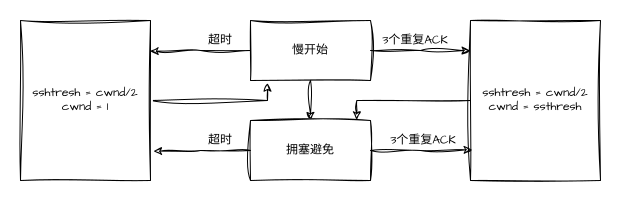

# 传输层  

---

## UDP与TCP简介

- UDP，User Datagram Protocol 用户数据报文协议

- TCP，Transmission Control Protocol 传输控制协议

### UDP与TCP的区别

- UDP支持单播、多播和广播
- TCP仅支持单播

### 熟知端口号

- tcp-BGP	179
- tcp-FTP	20/21
- tcp-HTTP	80
- tcp-HTTPS	443
- tcp-STMP	25
- tcp-POP3	110

- udp-RIP	520
- udp-DNS	53
- udp-DHCP	67/68

## UDP数据报首部

较为简单，如下：
```
	|  2byte  |  2byte |  2byte |  2byte |
	|  源端口  |目的端口|  长度   | 检验和 |
```

## TCP报文首部格式
```
	0                   1                   2                   3  
	0 1 2 3 4 5 6 7 8 9 0 1 2 3 4 5 6 7 8 9 0 1 2 3 4 5 6 7 8 9 0 1  
	+-+-+-+-+-+-+-+-+-+-+-+-+-+-+-+-+-+-+-+-+-+-+-+-+-+-+-+-+-+-+-+-+  
	|         源端口 (16位)          |       目的端口 (16位)         |  
	+-+-+-+-+-+-+-+-+-+-+-+-+-+-+-+-+-+-+-+-+-+-+-+-+-+-+-+-+-+-+-+-+  
	|                       序列号 (32位)  seq                      |  
	+-+-+-+-+-+-+-+-+-+-+-+-+-+-+-+-+-+-+-+-+-+-+-+-+-+-+-+-+-+-+-+-+  
	|                      确认号 (32位)   ack                      |  
	+-+-+-+-+-+-+-+-+-+-+-+-+-+-+-+-+-+-+-+-+-+-+-+-+-+-+-+-+-+-+-+-+  
	| 数据偏移 |保留 |N|C|E|U|A|P|R|S|F|       窗口大小 (16位)       |  
	|  (4位)  |(3位)|S|W|C|R|C|S|S|Y|N|                            |  
	|         |     | |R|E|G|K|H|T|T|N|                            |  
	+-+-+-+-+-+-+-+-+-+-+-+-+-+-+-+-+-+-+-+-+-+-+-+-+-+-+-+-+-+-+-+-+  
	|         校验和 (16位)          |       紧急指针 (16位)         |  
	+-+-+-+-+-+-+-+-+-+-+-+-+-+-+-+-+-+-+-+-+-+-+-+-+-+-+-+-+-+-+-+-+  
	|                       选项 (可变，0~40字节) ...               |  
	+-+-+-+-+-+-+-+-+-+-+-+-+-+-+-+-+-+-+-+-+-+-+-+-+-+-+-+-+-+-+-+-+  
	|                         数据 (可变) ...                       |  
	+-+-+-+-+-+-+-+-+-+-+-+-+-+-+-+-+-+-+-+-+-+-+-+-+-+-+-+-+-+-+-+-+  
```

- **源/目的端口**（各16位）：标识发送和接收的应用进程。

- **序列号**（32位）：本报文段第一个字节的序号，用于数据重组。

- **确认号**（32位）：期望收到对方下一个报文段的第一个字节序号，仅当ACK=1时有效，连接建立后所有传输的报文的ACK字段都置1。

- **数据偏移**（4位）：TCP头部总长度（以4字节为单位），最大60字节（20固定+40选项）。

- **保留**（3位）：置0。

- **标志位**（9位）：URG（紧急指针有效）、ACK（确认号有效）、PSH（推送）、RST（复位连接）、SYN（同步序号，建连）、FIN（终止连接），以及ECN相关的NS/CWR/ECE。

- **窗口大小**（16位）：发送方的接收窗口大小，用于流量控制。

- **校验和**（16位）：覆盖头部和数据（含伪头部），用于检错。

- **紧急指针**（16位）：URG=1时，指明紧急数据的末尾位置。

- 选项：如MSS（最大段大小）、时间戳、窗口扩大因子等，需结合Kind-Length-Value格式解析。

## TCP的可靠传输

### 连接建立-三次握手

1. 第一个报文段由客户端发起，中`SYN`置`1`，表示这是同步报文段，需要消耗序号，seq字段选取一随机值作为初始值，

2. 第二个报文段由服务器响应，`SYN`也置`1`，`ACK`置1，表示这是确认报文，ack字段设**客户端的报文段seq值加一**，表示确认收到对方序号seq+1之前的报文，期望收到对方序号seq+1的报文，自己的报文的seq字段选取随机值作为初始值

3. 第三个报文由客户端发送，`SYN`置`0`，表示这是普通报文段，可以携带发送数据也可以不带数据，如果没有携带数据则不消耗序号

> 如果第三个报文段没有数据，则下一次数据开始发送时不会等待确认报文段，而是使用与第三个报文段相同的seq和ack值发送数据，在服务端看来就是连续发送了两个seq和ack字段相同的报文段，只是第一个报文段没有数据

> 三次握手的主要目的是交换双方的初始序号seq，SYN标记关键的初始序号报文段

### 释放连接-四次挥手

结束连接中同样有关键的FIN标志位，可以看作双方结束连接报文的交换

1. 假设本端首先发送FIN结束报文，表示自己没有数据要发送了，与SYN相似，FIN报文虽然一般不携带数据但是也需要消耗一个序号，本端进入FIN-WAIT1状态，表示发送了FIN，正在等待对方发送剩余数据

2. 对端发送对FIN报文的确认，并进入CLOSE-WAIT状态，若仍有数据要发送，则继续发送，本端接收到数据进入FIN-WAIT2，表示发送了FIN，接收并等待对方传输数据完成，此时对于接收的数据回送ACK确认报文

3. 对端发送数据结束，此时可以发送自己的FIN结束报文了，发送后进入LAST-ACK状态，表示等待接收最后一个ACK确认报文

4. 本端收到后发送对该结束报文的确认报文，发送后进入TIME-WAIT状态，继续监听两个MSL，防止对端仍有数据发送，若没有收到数据则关闭；对端收到确认后就可以关闭了

> 监听两个MSL一方面可以防止自己发送的最后一个确认报文在传输过程中丢失而导致对方一直处于LAST-ACK状态无法关闭连接，另一方面可以确保本次连接的所有报文都传输完毕，避免下一次连接接收到本次连接的报文造成混乱

### 保活计时器

每收到一个报文就重置保活计时器，若到时未收到新的报文段，则间隔发送10次探测报文，都没收到响应则主动关闭连接

## TCP流量控制

- 通过接收方告知发送方接收窗口（rwnd）的大小来实现流量的控制，防止发送方发送过多数据，使得接收方缓冲区无法接收全部数据
- 发送方通过接收方的接收窗口大小来调整自己的发送窗口（swnd）的大小

### 零窗口探测报文

- 在收到接收方发送的零窗口通知报文段后启动计时器，超时则发送零窗口探测报文段

	> TCP对于每个连接都设有一持续计时器，接收到零窗口报文段就启动

- 携带有一字节的普通报文段，发送方发送后也需要启动重传计时器

	> 对于零窗口探测报文段、纯确认报文段和携带紧急数据的报文段，即使接收窗口为零也必须接收
## TCP拥塞控制

- 拥塞窗口cwnd
	- 发送窗口应该取接收方接收窗口与当前拥塞窗口的更小者

- 开环拥塞控制
	- 适用于网络的流量特征可以准确描述且性能指标明确，运行起来就不需要再采取措施

- 闭环拥塞控制
	- 采用基于反馈的的方式调整网络以解决拥塞

		1. 显式反馈算法 由节点向源点提供关于网络拥塞状态的显式反馈信息
		2. 隐式反馈算法 通过网络行为的观察来判断， 如重传或往返时间

### 慢开始和拥塞避免

> 方便起见，暂时忽略发送窗口的调整，假设接收方有足够大小的缓冲区接收数据

#### 慢开始

- 发送方的拥塞窗口初始报文段设置为1或2
	- 新的标准规定：
		1. 若SMSS（发送方最大报文段 Sender Maximum Segment Size）> 2190 Byte, cwnd = 2 * SMSS, 并且不超过两个报文段
		2. 若 2190 >= SMSS > 1095, cwnd = 3 * SMSS, 不超过三个报文段
		3. 若 1095 >= SMSS, cwnd = 4 * SMSS, 不超过四个报文段

- 每收到一个新的报文段的确认，cwnd就增加1，直到增加到慢开始门限 ssthresh (Slow Start Threshold ?)

#### 拥塞避免

超过ssthresh则开始执行拥塞避免，此时cwnd每次只增加1

- 一旦发送超时重传，则将`ssthresh`置为当前`cwnd/2`的大小，并重新执行慢开始算法，cwnd重新从1或2开始增加:
	```txt
	ssthresh = cwnd/2;
	ccwnd = 1;	// 2 or 3 or 4
	```

### 块重传和快恢复

为了改善TCP性能，使发送方尽快直到个别报文段的丢失，使用块重传算法

- 块重传
	- 接收方一旦接收到数据就立即发送确认报文，即使接收到失序报文也发送已接受的有序的报文段的确认
	- 发送方一旦接收到三个重复的确认报文（此时一共接收了该报文的四个确认报文），就直接重传该报文而不用等待重传计时器到时

- 块恢复
	- 触发了块重传（接收到三个重复ACK）就执行快恢复:
	```txt
	ssthresh = cwnd/2;
	cwnd = ssthresh;	// 有的方式是 cwnd = ssthresh +3;
	```
	- 然后线性增加

TCP拥塞控制的状态转移示意：



> 考虑接收窗口大小则发送方的发送窗口 swnd = min { rwnd, cwnd };
