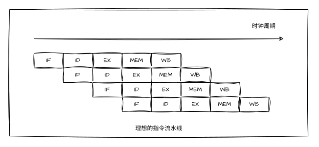
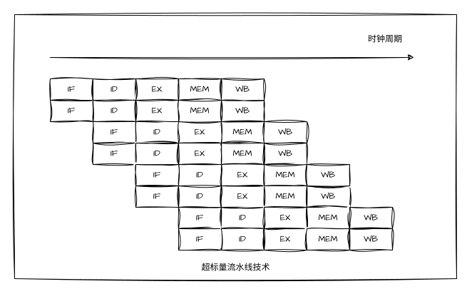

# 中央处理器结构

## 基本构成

- **控制单元** 负责取指令，指令译码到生成微控制信号，包含MAR、MDR和IR等寄存器（取决于具体的CPU结构）和译码单元和控制器等 

- **运算单元** 负责各种逻辑和算数运算，包含一系列通用寄存器组和ALU、程序状态字寄存器PSW等

> CPU中的程序计数器PC、程序状态字PSW和通用寄存器对用户来说是**可见**的，MAR、MDR和IR是**不可见的**

## 数据通路

### 执行部件

1. **操作元件** 属于组合逻辑元件，其**输出仅取决于当前输入**，常见有多路选择器MUX、加法器Adder、算术逻辑单元ALU等

> 算术逻辑单元ALU无法保存输入端数据，需要两个输入时，其中一个输入需暂存到寄存器中

2. **状态元件** 属于时序逻辑元件，具有存储功能，其输入由时钟控制下写到电路中，并保持输出不变，直到下一时钟信号到达，常见D触发器，n个D触发器可组成n位寄存器


## 指令的执行

- **单周期处理器**
    - 指令在一个时钟周期内完成，时钟周期取决于最耗时的指令
    - 时钟周期内控制信号无法改变
    - 性能较差

- **多周期处理器**
    - 指令由多个时钟周期内完成
    - 不同的时钟周期完成指令的不同阶段
    - 早期处理器多使用多周期处理器结构

- **指令流水线方式**
    - 现代处理器的执行方式

---

## 指令流水线

核心思想是将指令划分为不同固定的阶段，各阶段并行执行，像工厂流水线一样，充分利用CPU各部件

为了方便讨论，将指令的执行划分为如下五个阶段，并忽略中断周期，将重点放在提高指令的并行运行效率上

1. 取指 IF
2. 译码 ID
3. 执行 EX
4. 访存 MEM
5. 写回 WB



对于不同类型的指令，不同阶段执行的操作不同

```
| 流水段 | ALU型 | load/store型 |     转移指令     |
===================================================
|   IF   |                取 指                   |
---------------------------------------------------
|   ID   |            译 码 & 读寄存器堆           | 
---------------------------------------------------
|   EX   | 执行 |  计算有效地址  |   计算转移地址   |
---------------------------------------------------
|   MEM  | ---- |     访 存     | 条件成立则修改PC |
---------------------------------------------------
|   WB   |      写回寄存器       |       ---      |
---------------------------------------------------
```

- 理想的指令流水线充分流水后CPI为1，指令周期为1，机器周期为1  
- 实际的指令流水线中难免会有指令因为资源争夺而发生冲突，主要有数据相关和结构相关、控制相关

### 结构冒险

即结构相关或称硬件相关的冲突，以访存为例，假设同一时刻某一指令在IF取指阶段，且需访存取到指令，而并行执行的另一指令在访存阶段，并该指令要访存，此时发生争用主存的冲突，一般有如下几种解决方法

1. 延后该指令的取指阶段（因为该指令是晚于另一访存指令进入流水线的）
2. 设置两个存储器，分别存放指令和数据（即增加硬件资源）
3. 使用指令预取技术

### 数据冒险

即由于指令的部分阶段并行发生，可能造成对操作数访问顺寻的改变，从而导致数据相关的冲突
例如，某一指令需要使用前一条指令的计算结果，但是其执行到取寄存器时前一指令还未写回寄存器，将导致该指令取出错误的操作数
解决方法有这几种
1. 推后后一指令的执行，实现思路相似，具体有这几种
    - 编译器在指令之间增加空指令
    - 停顿后一指令的执行，直到前一指令写回操作完成
2. **数据旁路**
    - 思路是直接将该结果送至需要使用的地方，而不必等待其写回寄存器后再读出，下面具体介绍

#### 数据旁路

- 根据对寄存器读写次序的不同，数据冲突相关分为如下

1. **写后读**
    后一读指令先于前一写指令读出寄存器，后一指令会读出错误内容
2. **读后写**
    后一写指令先于前一读指令写入寄存器，前一指令会读出错误内容
3. **写后写**
    后一写指令先于前一写指令写入寄存器，两次写操作次序被颠倒导致最后被写入错误的内容

**注意！在按序流动的流水线中，只有写后读RAW会发生冲突**
> 在非按序流动的流水线中，可能发生另外两种冲突

**写后读**，**RAW** Read After Write ，或称**load-use冒险**，这种情况下可以使用数据旁路和暂停后一指令的流动来避免冲突

### 控制冒险

主要由转移指令引起，当发生转移时，该指令后续进入流水线的指令可能被全部废弃，和数据冒险相比使流水线丧失更多性能，为此可提前预测转移是否发生、加快或提前条件码的形成、提高预测准确性等

### 流水线的多发技术

#### 超标量技术

即并行地完成多个指令的执行，可使CPI减少到小于一，不过执行的指令需要是无冲突、可并行的



#### 超流水线技术

即将流水线中的各阶段再划分为流水线，使得流水线间隔比普通流水线更短，假设一个阶段划分为三段，即可使流水线以原先三倍的速度运行

#### 超长指令字技术

需要依靠编译器挖掘出指令之间的并行性，将其合并为一条具有多个操作码字段的超长指令，可达几百位，同时控制多个功能部件并行执行指令
